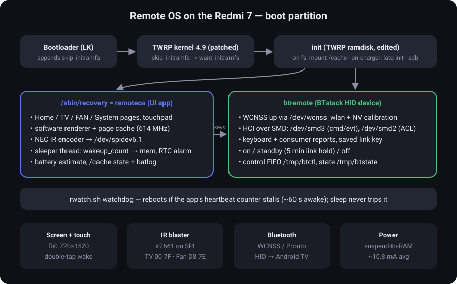

# Remote OS

**Turn an old Android phone into a dedicated room remote — no Android, no apps, just a remote.**

Remote OS replaces Android on a **Xiaomi Redmi 7** with a tiny native system that boots straight into one
full-screen remote app. It controls an Android TV (IR **and** Bluetooth — no pointing needed) and a BLDC ceiling
fan through the phone's built-in IR blaster, sleeps between uses and lasts about **two weeks per charge**.



---

## Why

An old phone with a cracked case and broken buttons still has a great screen, an IR blaster, Bluetooth and a big
battery. Running stock Android as a remote wastes all of it: ~40 s boot, background services, 3–4 days per charge.
Remote OS keeps only what a remote needs.

| | Android + remote app | **Remote OS** |
|---|---|---|
| Boot time | ~40 s | **~20 s** |
| Battery (measured, heavy use ~47 wakes/day) | ~3–4 days | **~14 days** (≈10.8 mA average, ≈6.6 %/day) |
| Time spent in deep sleep | — | **98 %** |
| Background services | Google, cellular, sync… | **none** (cellular modem never starts) |
| Size of the system | GBs | **~2 MB of our code** on a TWRP ramdisk |

---

## Features

- **Home page** with only the essentials, laid out for one-handed reach (rare/"dangerous" keys at the top, frequent
  keys in the thumb zone): TV / Fan / AC power, AC + Light placeholders, fan speeds 1–7 + Eco, a large **touchpad**
  (swipe = arrows, tap = OK), tall volume rocker, big Home / Back / Mute keys.
- **TV page**: every key — Power, Input, Mute, Netflix, round D-pad, Back/Home/Exit, VOL/CH rockers with hold-repeat,
  Settings, Info, Media, rewind / play-pause / fast-forward.
- **Fan page**: Power, speeds 1–7 (remembers the last speed sent), Light, Reverse, Eco, 2 h / 4 h timers.
- **System page**: live battery estimate, gauge value, uptime, sleep statistics, brightness, Bluetooth pairing,
  Restart, Recovery (TWRP).
- **Bluetooth HID remote**: the phone pairs with the TV as a keyboard + media remote; when connected, TV keys go over
  Bluetooth (works from anywhere in the room). The link is held for 5 minutes after the screen goes off, so waking
  the phone again is instantly connected; after that the radio switches off.
- **Native IR**: drives the `ir2661` IR chip directly over SPI (protocol reverse-engineered from Xiaomi's IR HAL).
- **Power management**: screen off after 5 s idle, suspend-to-RAM 3 s later, **double-tap to wake**, CPU capped at
  614 MHz on 4 cores, low-battery shutdown by voltage, auto-boot when a charger is connected.
- **Short vibration** on every key, smooth anti-aliased UI (~15 ms redraw with page caching).
- **Safe operations**: watchdog, one-command `deploy.sh` with SHA-256 verified flashing, persistent battery log.

> Screenshots: coming soon (captured from the device into `assets/screenshots/`).

---

## Tested device

| | |
|---|---|
| **Phone** | Xiaomi **Redmi 7** (codename **`onclite`**) |
| SoC | Qualcomm Snapdragon 632 (SDM632, msm8953 family), 8× Cortex-A53 up to 1.8 GHz, PMICs PM8953 + PMI632 |
| RAM / storage | 3 GB / 32 GB eMMC |
| Display / touch | 6.26" IPS LCD 720×1520, Goodix GT1158 (gt1x) with double-tap gesture |
| IR blaster | `ir2661cl510` on SPI (`/dev/spidev6.1`) |
| Bluetooth / Wi-Fi | Qualcomm WCNSS / Pronto with iris RF (Bluetooth 5.0) |
| Battery | 4000 mAh (ATL), QG fuel gauge |
| Other | FPC1020 fingerprint (unused), vibrator |
| Condition of the test unit | **power and volume buttons physically broken** — everything is designed to work without them |
| Bootloader | unlocked |
| Recovery used as template | TWRP 3.5.1_9 (by KostyaJRZ) for onclite |
| Kernel | 4.9.268-perf (from the TWRP image) |
| Previous ROM | AOSP 11 (RQ2A.210505.003) with Magisk — not needed by Remote OS |

**Controlled devices (tested):**

| Device | Link | Codes |
|---|---|---|
| 32" Android TV sold as "Nova" (Smarttech/Expressluck Apollo, MStar/MediaTek MT5867, Android TV 11) | IR + Bluetooth HID | NEC extended, address `00 7F` |
| Walton Super Saver-IR BLDC ceiling fan | IR | NEC extended, address `D8 7E` |

Other phones: the approach (TWRP ramdisk + native app + direct hardware access) carries over, but IR chip encoding,
Bluetooth bring-up and screen/touch paths are device-specific. See `AGENTS.md` §2 and §8 for how to probe a new phone.

---

## How it works (short)

1. **Boot image** = the phone's TWRP recovery kernel + TWRP's ramdisk, with TWRP's `/sbin/recovery` replaced by the
   remote app and two services added (`btremote`, watchdog). The kernel string `skip_initramfs` is renamed to
   `want_initramfs` (as Magisk does) so the ramdisk is used when booting from the **boot** partition.
2. **The app** (`app/remoteos.c`, one C file) draws directly on the framebuffer with a small anti-aliased renderer and
   baked Noto Sans fonts, reads the touchscreen, encodes NEC IR into the bitstream the IR chip expects and writes it
   to SPI.
3. **Sleep**: a sleeper thread suspends the phone (`/sys/power/state = mem`) whenever the screen is off; touchscreen
   double-tap, an RTC alarm (Bluetooth link deadline or 5-hour battery check) or a charger wakes it.
4. **Bluetooth** (`bt/btremote.c`): powers up the WCNSS core like Android does (firmware from `modem`, RF
   calibration from `persist`, read-only), talks HCI over the SMD channels, and runs **BTstack** as a HID device.
5. **State** (fan speed, brightness, Bluetooth keys, battery log) lives on the `cache` partition.

Full details, every gotcha and the debugging toolbox: **[AGENTS.md](AGENTS.md)**.

---

## Install (Redmi 7)

> ⚠️ This replaces the phone's operating system. Read [AGENTS.md §7](AGENTS.md) (safety rules) first. Make a full
> backup. Never use `fastboot boot` on a phone without working buttons.

Requirements: Linux PC with `adb`, `git`, `curl`, `python3`; a Redmi 7 with **unlocked bootloader**, **TWRP** in the
recovery partition, and root access (TWRP shell is enough).

```bash
git clone https://github.com/inzzrahat2/remote-os.git && cd remote-os
tools/setup.sh                                   # fetches Zig 0.13.0 (sha-verified) + BTstack v1.6.1 into tools/

# 1. reboot the phone into TWRP and make a FULL backup of every partition (example: one partition)
adb reboot recovery
adb exec-out "dd if=/dev/block/by-name/persist" | gzip > persist.img.gz     # repeat for all partitions!

# 2. use your own TWRP image as the template
adb exec-out "dd if=/dev/block/by-name/recovery" > boot/recovery.img

# 3. build the app, the Bluetooth daemon and the boot image
tools/zig-linux-x86_64-0.13.0/zig cc -target aarch64-linux-musl -static -O2 -o app/remoteos app/remoteos.c -lm
bt/build.sh
(cd boot && python3 build_image.py ../app/remoteos remoteos-boot.img --boot)

# 4. flash it to the boot partition from TWRP and verify
adb push boot/remoteos-boot.img /tmp/ro.img
adb shell "dd if=/tmp/ro.img of=/dev/block/by-name/boot bs=4194304 && sync"
adb reboot
```
After the first install, use `./deploy.sh` for every update (it builds, flashes, verifies the SHA-256 and reboots).

**Pair the TV over Bluetooth (once):** TV on → on the phone open **…** (System) → **Pair TV (Bluetooth)** → on the
TV open *Settings → Remotes & Accessories → Add accessory* and pick **Nova Remote** (or confirm the pairing dialog
if the TV address is already known).

**Get back to Android:** flash your backed-up `boot.img` to the `boot` partition.

---

## Development

```bash
./deploy.sh          # build + flash + verify + reboot + status
./deploy.sh ram      # run a new build from RAM (nothing flashed; a reboot reverts)
./deploy.sh status   # version, services, Bluetooth, battery, CPU
```
Optional `LOCAL.env` (git-ignored): `SERIAL=<adb serial>`, `BT_ADDR=<Bluetooth address to keep>`.

Debug commands (from the PC): `adb shell 'echo "page 0" > /tmp/cmd'` (0 Home, 1 TV, 2 Fan, 3 System),
`echo "tap X Y" > /tmp/cmd`, `echo shot > /tmp/cmd` (screenshot to `/tmp/shot.raw`), `touch /tmp/wake`.
Logs: `/tmp/remoteos.log`, `/tmp/btremote.log`, `/cache/remoteos/batlog.csv`.

```
app/        remoteos.c (the app), fonts.h + bake_fonts.py, hcitest.c (Bluetooth smoke test)
bt/         btremote.c (Bluetooth HID daemon), btstack_config.h, build.sh
boot/       build_image.py (boot image builder), rwatch.sh (watchdog)
re/         spi_ir.py — reference encoder for the IR chip's SPI bitstream
tools/      setup.sh (fetches Zig + BTstack)
assets/     diagrams and screenshots
deploy.sh   one-command build/flash/verify
AGENTS.md   full technical guide (for humans and AI coding agents)
```

---

## Limitations

- Device-specific (Redmi 7 / onclite). The IR SPI encoding, WCNSS bring-up and screen paths must be re-probed on
  other phones.
- The fuel gauge only computes its percentage at boot without Android; Remote OS shows a voltage-based estimate.
- Wake-on-pickup is not possible cheaply (accelerometer is behind the sensor DSP); wake is double-tap.
- The Bluetooth/Wi-Fi core cannot be fully powered off from userspace; the radio is switched off instead.
- AC and Light are placeholders (AC needs the brand/model to implement its full-state protocol).

## Credits & licences

Remote OS code: MIT (see [LICENSE](LICENSE)). Uses [BTstack](https://github.com/bluekitchen/btstack) (BlueKitchen,
free for non-commercial use), Noto Sans (SIL OFL 1.1), Zig (MIT), and your device's TWRP image as the template
(not distributed). The TV codes were recovered from the TV's own Bluetooth-remote firmware; the fan codes from a
public fan-remote app.
